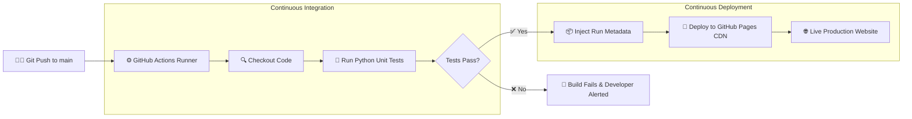

# 🚀 Automated CI/CD Test Website

An end-to-end demonstration of modern **Continuous Integration (CI)** and **Continuous Deployment (CD)** powered by **GitHub Actions** and **GitHub Pages**.

---

## 📖 What is CI/CD?

**CI/CD** bridges the gap between development and operations by automating the building, testing, and deployment of applications:

### 1. Continuous Integration (CI)
* **Goal:** Merge code changes frequently without breaking the main codebase.
* **Mechanism:** Every push or pull request automatically triggers automated linters, syntax validators, and test suites (`unittest`).
* **Benefit:** Detects bugs within seconds of writing code, preventing regression errors.

### 2. Continuous Delivery & Continuous Deployment (CD)
* **Continuous Delivery:** Automates packaging and prepares deployable artifacts ready for production with one click.
* **Continuous Deployment:** Takes every commit that passes the CI pipeline and releases it directly to the live production environment without human intervention.

---

## 🔄 The CI/CD Pipeline Flow



---

## 🛠️ Project Structure

```
├── .github/
│   └── workflows/
│       └── deploy.yml      # CI/CD pipeline definition
├── assets/
│   ├── app.js              # Interactive client simulation & DOM tests
│   └── style.css           # Modern dark-theme glassmorphism UI
├── tests/
│   └── test_website.py     # Automated test suite executed by CI runner
├── index.html              # Main responsive web portal
└── README.md               # Documentation & setup guide
```

---

## 🧪 Running Tests Locally

You can run the same automated test suite executed by the CI server on your local machine:

```bash
python3 -m unittest discover -s tests -p "test_*.py" -v
```

---

## ⚙️ Enabling GitHub Pages (One-Time Setup)

Once the code is pushed to your GitHub repository:
1. Open the repository on GitHub: `https://github.com/aishwar2/<repo-name>`
2. Go to **Settings** > **Pages** (in the left sidebar).
3. Under **Build and deployment** > **Source**, select **GitHub Actions**.
4. The workflow will run automatically on the next push or manual trigger!
5. Your live site will be available at:
   `https://aishwar2.github.io/<repo-name>/`
