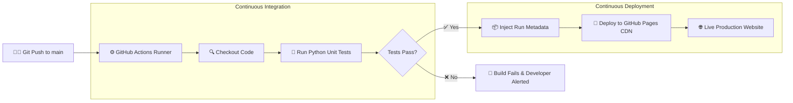

# 🚀 Automated CI/CD Test Website

An end-to-end demonstration of modern **Continuous Integration (CI)** and **Continuous Deployment (CD)** powered by **GitHub Actions** and **GitHub Pages**.

---

## 📖 What is CI/CD?

**CI/CD** bridges the gap between development and operations by automating the building, testing, and deployment of applications:

### 1. Continuous Integration (CI)
* **Goal:** Merge code changes frequently without breaking the main codebase.
* **Mechanism:** Every push or pull request automatically triggers automated linters, syntax validators, and test suites (`unittest`).
* **Benefit:** Detects bugs within seconds of writing code, preventing regression errors.

### 2. Continuous Delivery & Continuous Deployment (CD)
* **Continuous Delivery:** Automates packaging and prepares deployable artifacts ready for production with one click.
* **Continuous Deployment:** Takes every commit that passes the CI pipeline and releases it directly to the live production environment without human intervention.

---

## 🔄 The CI/CD Pipeline Flow



---

## 🛠️ Project Structure

```
├── .github/
│   └── workflows/
│       └── deploy.yml      # CI/CD pipeline definition
├── assets/
│   ├── app.js              # Interactive client simulation & DOM tests
│   └── style.css           # Modern dark-theme glassmorphism UI
├── tests/
│   └── test_website.py     # Automated test suite executed by CI runner
├── Dockerfile              # Production Nginx Alpine container definition
├── docker-compose.yml      # Local container orchestration
├── nginx.conf              # High-performance Nginx config with /health check
├── index.html              # Main responsive web portal
└── README.md               # Documentation & setup guide
```

---

## 🐳 Docker Deployment & CI/CD

### 1. Run locally with Docker Compose
```bash
docker compose up -d
```
Visit the website at `http://localhost:8080` (or `http://localhost:8080/health`).

### 2. Build and run directly with Docker CLI
```bash
# Build the production image
docker build -t cicd-test-website:latest .

# Run container on port 8080
docker run -d --name my-website -p 8080:80 cicd-test-website:latest
```

### 3. Automated Docker CI/CD Pipeline
Every push to `main` automatically:
1. Runs tests in Python runner (`unittest`).
2. Builds and validates the Docker image.
3. Performs a live container health-check.
4. Pushes the image to **GitHub Container Registry (GHCR)**:
   ```bash
   docker pull ghcr.io/aishwar2/demo:latest
   ```
5. Deploys to **GitHub Pages CDN**.

---

## 🧪 Running Tests Locally

You can run the same automated test suite executed by the CI server on your local machine:

```bash
python3 -m unittest discover -s tests -p "test_*.py" -v
```

---

## ⚙️ Enabling GitHub Pages (One-Time 10-Second Setup)

To allow GitHub Actions to publish the site to GitHub Pages:
1. Open repository settings: [demo/settings/pages](https://github.com/aishwar2/demo/settings/pages)
2. Under **Build and deployment** > **Source**, change from *Deploy from a branch* to **GitHub Actions**.
3. Go to [demo/actions](https://github.com/aishwar2/demo/actions), click **CI/CD Pipeline & GitHub Pages Deploy** > **Re-run all jobs**.
4. Your live website is immediately published at:
   👉 **https://aishwar2.github.io/demo/**
